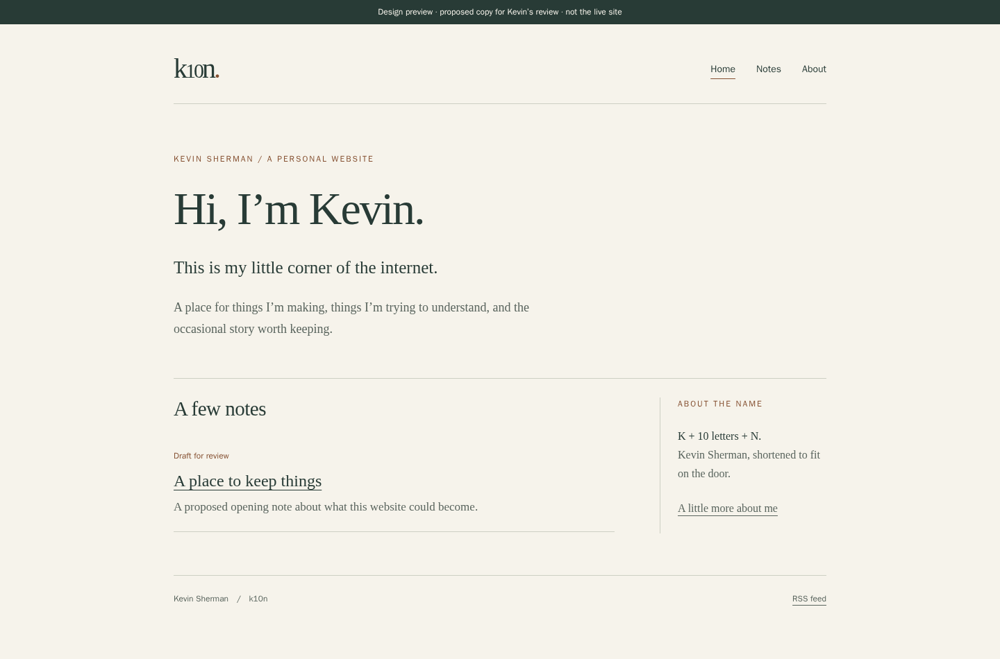

# k10n design review

**Review only: not merged or deployed. All new editorial copy needs Kevin's approval.**

## Recommendation: Commonplace Book

Warm paper, green-black ink, restrained rust accents, serif reading type, thin rules and a small margin note explaining the domain. Uses familiar system fonts rather than downloads. Light/dark follows the reader's system preference without scripts. No animation, commercial hero, achievement grid or social proof.

Three concepts: [comparison](preview/concepts.png) / [HTML concept sheet](preview/concepts.html).

1. **Commonplace Book (recommended):** feels comfortable with technical notes, reflections and older stories. The personality comes from the writing; it doesn't demand lots of material at launch.
2. **Field Notes:** cool ink, compact sans-serif headings, numbered entries. More technical, less natural for personal stories.
3. **Personal Archive:** warm brown, album-like spacing and an optional photo slot. Strong potential later, but it needs a curated collection and explicit photo-placement approval.

Reviewed independent sites: [Derek Sivers](https://sive.rs/) for direct, personal navigation; [Jeremy Keith](https://adactio.com/) for short and long entries sharing a living site; [Maggie Appleton](https://maggieappleton.com/) for room for unfinished ideas. Their layouts, personal facts and copy were not reused. Avoided their scale/density and features the new site doesn't yet need.

## Screenshots

[Mobile](preview/mobile.png) · [Dark mode](preview/dark.png)

Screenshots show the **review build**, including one conspicuously labeled draft. A normal build excludes that draft, its link, and Notes navigation until a note is approved. Both variants were tested. The private review build can be regenerated using the README; it has not been placed on a public preview service.

## Structure

- Home: introduction, explanation of k10n, latest three visible notes (or a short quiet invitation to future writing).
- About: modest introduction and the domain's meaning.
- Notes: chronological Markdown collection, individual clean URLs, optional tags. No tag navigation until useful.
- RSS, sitemap, robots, custom 404.
- Existing `/tower-backup/`, `/tower-backup/privacy/`, historical image and asset URLs unchanged.
- No Now page until Kevin supplies current information; no Projects gallery without actual project entries; no personal Contact link without approval.

## Proposed homepage copy

> Hi, I’m Kevin.
>
> This is my little corner of the internet.
>
> A place for things I’m making, things I’m trying to understand, and the occasional story worth keeping.
>
> K + 10 letters + N. Kevin Sherman, shortened to fit on the door.

Without a published note, the lower section reads: “Room to write — Technical notes, everyday observations, and longer stories can all find a home here. No particular schedule.”

## Content decisions for Kevin

1. Approve or edit the Home and About wording. It derives from the supplied brief, but is proposed voice, not a quotation or independently verified biography.
2. Keep the sample “A place to keep things” as a draft, revise it, or explicitly approve publication. There are no fabricated personal experiences. Recommended default: launch Home + About until there's something Kevin genuinely wants to publish.
3. The original family photo is preserved, not newly displayed. Decide later whether to place it in a history note, with an approved caption. No extra photos, family names, employment history, beliefs or sensitive personal details were introduced.
4. No new public contact information was added. The previously approved OAuth support address remains on its original pages. Using the domain for email was not treated as consent to display that mailbox on the personal site.

## Implementation and checks

Astro static generation + TypeScript; Markdown collection; draft-safe routes/feed/sitemap; local CSS; no runtime JS or external scripts/fonts. Original root source files remain untouched as historical source. Seven retained assets/OAuth files are verified byte-for-byte against the deployed baseline in both public source and output. See README for maintenance and docs/DEPLOYMENT.md for release/rollback.

Review browser checks: 7 routes × 4 widths (320, 390, 768, 1440) × 2 themes = **56 passing checks**, no overflow or automated axe violations. Skip-link focus, no-JS navigation and OAuth privacy link pass. Build/type checks pass with no errors/warnings/hints. Automated scans are not full accessibility conformance certification.

Production-mode checks additionally verify draft exclusion, internal links and custom 404 behavior. Current nginx needs a separately approved web-only adjustment for actual HTTP 404 on production. Neither DNS nor email configuration needs any change. A new full pre-release backup must include the already-live OAuth pages; the older pre-OAuth backup is insufficient for this redesign.
